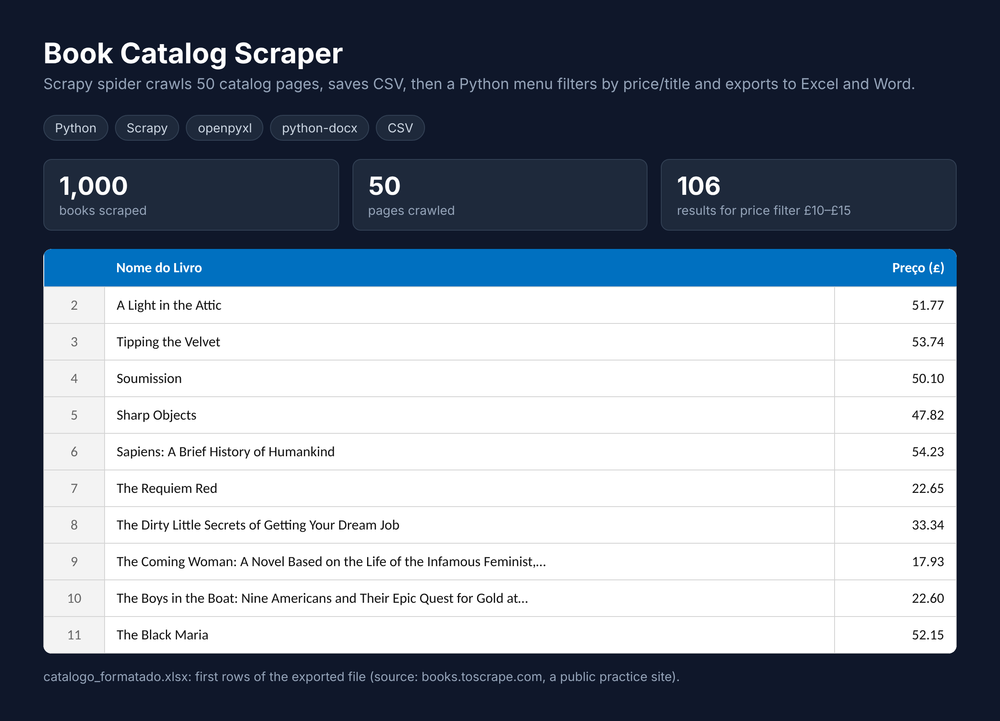

# Rastreador de Preços: Catálogo de Livros

Projeto em duas partes, feito em Python:

1. **Coleta com Scrapy**: um spider percorre as 50 páginas do site de treino books.toscrape.com e salva o nome e o preço de 1.000 livros no `catalogoCompleto.csv`.
2. **Programa de terminal**: lê esse CSV para pesquisar, filtrar e exportar os livros para Excel e Word.

Neste projeto treinei raspagem de dados, arquitetura modular, leitura de arquivos CSV, formatação de strings, uso de variáveis de estado (flags) e exportação de relatórios.

## Coleta dos dados (Scrapy)

Para coletar o catálogo de novo:

- **pip install scrapy**
- **scrapy crawl livros -O catalogoCompleto.csv**

O spider fica em `rastreadorPrecos/spiders/livros.py`.

## O que ele faz

- **Filtrar por preço**: pede um valor mínimo e máximo e lista na tela todos os livros que estão dentro desse orçamento.

- **Procurar títulos**: busca por palavras-chave no nome do livro, ignorando letras maiúsculas, minúsculas e espaços em branco.

- **Exportar catálogo**: permite exportar a lista completa de livros do arquivo CSV para um arquivo Excel (com cores e tamanhos ajustados) ou para um arquivo Word (com formatação em negrito).

O menu aceita o número da opção ou o nome dela (por exemplo, `1` ou `preço`). Se a pessoa digitar algo parecido, o programa sugere a opção certa ("Você quis dizer...?").

## Como rodar

Você precisa do Python 3 instalado. Além disso, é necessário instalar duas bibliotecas externas para a geração dos arquivos de exportação.

Instale as dependências com:

- **pip install openpyxl python-docx**

Depois, execute o arquivo principal:

- **python main.py**

## Menu

1 - Filtrar por preço

2 - Procurar titulos

3 - Exportar Catálogo

4 - Encerrar

## Arquivos exportados

Os arquivos são salvos na mesma pasta do programa quando a opção 3 é escolhida. O sistema interage com o usuário para saber qual formato ele prefere.

Se escolher Excel, ele gera o `catalogo_formatado.xlsx`, que já vem com as colunas alargadas e o cabeçalho estilizado (letra branca e fundo azul).

Se escolher Word, ele gera o `Catalogo_de_livros.docx`, estruturado com um título principal e a lista de livros formatada em parágrafos, colocando o nome da obra em negrito.

## Limitações

O programa não acessa a internet em tempo real. Ele depende obrigatoriamente do arquivo estático `catalogoCompleto.csv` (gerado previamente via Scrapy) estar na mesma pasta para conseguir ler os dados. 

## O que pratiquei neste projeto

- Arquitetura modular (separando a interface no `main.py` e a lógica no `funcoes.py`)

- Leitura de arquivos com o gerenciador de contexto `with open` e `csv.DictReader`

- Manipulação de strings e conversão de tipos (`strip`, `lower`, `replace`, `float`)

- Laços `while` e `for`

- Controle de fluxo com variáveis de estado (flags)

- Exportação de planilhas formatadas com `openpyxl`

- Exportação de documentos formatados com `python-docx`

- Sugestão de opção parecida com `difflib.get_close_matches`
